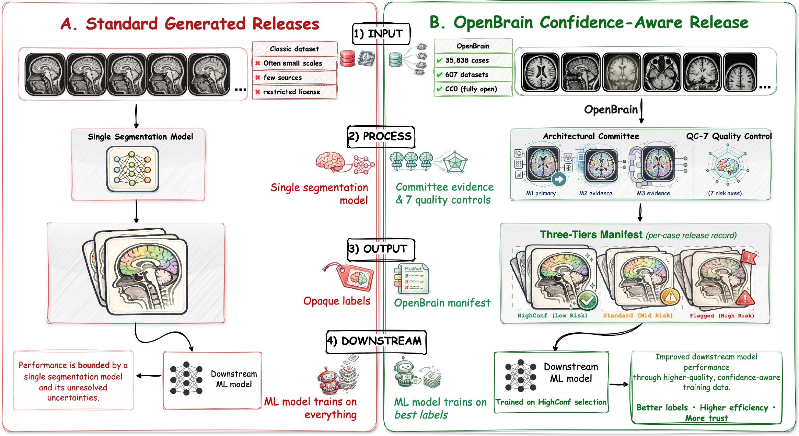
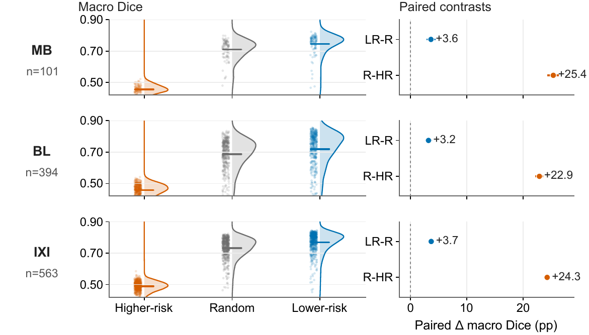
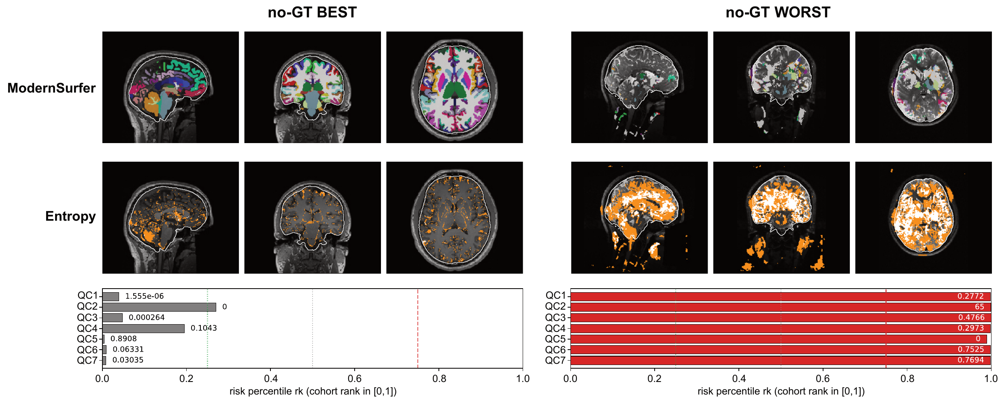

<h1 align="center">OpenBrain</h1>

<p align="center"><strong>An Auditable Generated-Label Release for Whole-Brain MRI Parcellation</strong></p>

<p align="center">
  <a href="https://openreview.net/forum?id=dR9OMtUEEC"></a>
  <a href="https://huggingface.co/datasets/lanqz7766/OpenBrain"></a>
  <a href="https://huggingface.co/datasets/lanqz7766/OpenBrain/blob/main/LICENSE"></a>
  <a href="./LICENSE"></a>
</p>

<p align="center">
  Qizhen Lan · Yu-Chun Hsu · Yuxiang Wei · Lijing Zhu<br>
  Zenan Sun · Liang He · Lishan Yu · Xiaoqian Jiang<sup>†</sup><br>
  <sub><sup>†</sup>Corresponding author<br>
  Contact: <a href="mailto:Qizhen.Lan@uth.tmc.edu">Qizhen.Lan@uth.tmc.edu</a></sub>
</p>

<p align="center">
  <a href="https://openreview.net/forum?id=dR9OMtUEEC">https://openreview.net/forum?id=dR9OMtUEEC</a><br>
  <a href="https://huggingface.co/datasets/lanqz7766/OpenBrain">https://huggingface.co/datasets/lanqz7766/OpenBrain</a>
</p>

<p align="center">
  <a href="#results">Results</a> · <a href="#quality-checks">Quality checks</a> · <a href="#download">Download</a> · <a href="#usage">Usage</a> · <a href="#citation">Citation</a>
</p>

**Accepted at NeurIPS 2026, Evaluations & Datasets Track.**

Whole-brain MRI parcellations for 35,838 public T1-weighted scans, each with a per-case quality record.

<p align="center">
  <a href="assets/overview.png"></a><br>
  <sub>Figure 1 · A standard generated-label release (left) and OpenBrain (right)</sub>
</p>

| Scans | Source datasets | Regions per scan | Quality checks per scan | License |
|:---:|:---:|:---:|:---:|:---:|
| **35,838** | **607** | **110** | **7** | **CC0** |

The scans come from 607 OpenNeuro datasets. Each has a brain mask and a
110-region parcellation produced by ModernSurfer, a 3D residual U-Net trained
on FreeSurfer labels. The labels are model output, not manual annotation.
Every scan also carries seven automatic quality checks, a combined risk score
`R`, and a confidence tier, so that users can decide which cases to use. This
repository contains the code for the checks, for building training subsets,
and for the experiments in the paper.

## Results

We trained nnU-Net on 1,000 cases from the low-risk end of the release, 1,000
random cases, and 1,000 from the high-risk end, and evaluated on three
external cohorts.

<p align="center">
  <a href="assets/training_selection.png"></a><br>
  <sub>Figure 2 · Macro Dice of nnU-Net trained on higher-risk, random, and lower-risk selections</sub>
</p>

The lower-risk model beats the random one by 3.2 to 3.7 Dice points on all
three cohorts (paired 95% CIs exclude zero), and the higher-risk model trails
by more than 20 points. Within a cohort, keeping the quarter of cases with the
lowest `R` raises macro Dice by 1.3 points on IXI, 3.7 on BrainLat, and 1.5 on
Mindboggle-101, the cohort with manual labels. The lower-risk and random training sets differ in
source composition as well as in risk, and IXI and BrainLat use
FreeSurfer-derived references; see the Limitations section of the paper.

## Example

A low-risk and a high-risk case from the release: parcellation, voxel
disagreement among the three models, and the seven checks as within-dataset
percentiles.

<p align="center">
  <a href="assets/release_examples.png"></a><br>
  <sub>Figure 3 · A low-risk (left) and a high-risk (right) case from the release</sub>
</p>

## Quality checks

| | Check | High value means |
|---|---|---|
| Q1 | mask leakage | labels outside the brain mask |
| Q2 | volume outliers | region volumes unusual for the source dataset |
| Q3 | distant fragments | pieces of a region far from its main body |
| Q4 | intensity variation | large intensity spread inside a region |
| Q5 | committee overlap | agreement with SwinUNETR and UNETR (high is good) |
| Q6 | vote uncertainty | voxel-level disagreement among the three models |
| Q7 | volume disagreement | region volumes differ among the three models |

Each check is converted to a percentile within its OpenNeuro dataset, with Q5
inverted so that higher always means riskier. `R` is the mean of the seven
percentiles. Sorting the release by `R`, the lowest quarter is HighConf, the
middle half Standard, and the top quarter Flagged. Raw values are released, so
other weightings and cutoffs are possible.

## Release contents

- `image.nii.gz`: skull-stripped T1w, 1 mm isotropic
- `brain_mask.nii.gz`: SynthStrip mask
- `whole_brain_segmentation.nii.gz`: 110-region parcellation
- `metadata/openbrain_v1_0_qc_manifest.csv`: `Q1` to `Q7`, `r1` to `r7`, `R`, tier
- `metadata/openbrain_v1_0_metadata.csv`: OpenNeuro dataset, snapshot, DOI, license, original path, and age, sex, and scanner fields where available

Case ids look like `ds000001__sub-01__ses-DEFAULT__sub-01_T1w`.

## Download

```bash
# metadata and QC manifest, about 55 MB
hf download lanqz7766/OpenBrain --repo-type dataset --local-dir openbrain_v1_0 \
    --include "metadata/**" --include "croissant.json" --include "LICENSE"

# 64-case sample
hf download lanqz7766/OpenBrain --repo-type dataset --local-dir openbrain_v1_0 --include "sample/**"

# full release, about 350 GB
hf download lanqz7766/OpenBrain --repo-type dataset --local-dir openbrain_v1_0
```

```python
import pandas as pd
m = pd.read_csv("openbrain_v1_0/metadata/openbrain_v1_0_qc_manifest.csv")
high_conf = m[m["tier"] == "HighConf"]
strict    = m[(m["R"] < 0.3) & (m["r1"] < 0.8)]
```

## Usage

```bash
git clone https://github.com/lanqz7766/openbrain.git && cd openbrain
pip install -e .

python -m qc --help
python -m qc --case-dir <cases> --m1-dir <primary> --m2-dir <committee_2> --m3-dir <committee_3> --output qc.csv
```

Q2 is fit per dataset and needs more than one scan. Q5 to Q7 need the two
committee outputs; without them those columns are NaN.

`REVIEWER_REPLICATION.md` reproduces the tier counts, retention curves, paired
training-selection contrasts, and small-structure analysis from the released
manifest and an evaluation cohort of your own.

```
qc/          the seven checks, percentile conversion, R and tier
selection/   lower-risk, random, and higher-risk training subsets
eval/        macro Dice, retention sweep, axis correlations, paired contrasts
examples/    sample download and PNG preview
data/        label map, 96-region evaluation set, 16-region small-structure set, manifest schema
```

## Limitations

The parcellations follow the FreeSurfer convention of the training labels.
`R` ranks cases within a dataset and is not a probability of error. Age, sex,
and scanner metadata are incomplete, so the release does not support fairness
analyses. The data and code are for research use, not clinical use.

## Citation

```bibtex
@inproceedings{lan2026openbrain,
  title     = {OpenBrain: An Auditable Generated-Label Release for Whole-Brain MRI Parcellation},
  author    = {Lan, Qizhen and Hsu, Yu-Chun and Wei, Yuxiang and Zhu, Lijing and Sun, Zenan and He, Liang and Yu, Lishan and Jiang, Xiaoqian},
  booktitle = {Advances in Neural Information Processing Systems (NeurIPS), Evaluations and Datasets Track},
  year      = {2026}
}
```

Code: MIT. Data: CC0. Source scans are from OpenNeuro under CC0 or equivalent terms.

