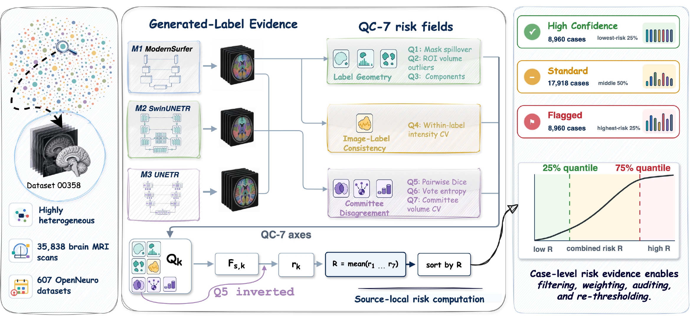

# OpenBrain

**OpenBrain: An Auditable Generated-Label Release for Whole-Brain MRI Parcellation**
NeurIPS 2026, Evaluations & Datasets Track.

[Paper (OpenReview)](https://openreview.net/forum?id=dR9OMtUEEC) · [Dataset (Hugging Face)](https://huggingface.co/datasets/lanqz7766/OpenBrain) · [Datasheet](DATASHEET.md) · [Replication guide](REVIEWER_REPLICATION.md)

OpenBrain is a public release of 35,838 T1-weighted brain MRI cases from 607
OpenNeuro datasets with CC0 or public-domain-compatible licenses. Every case
ships with a whole-brain parcellation produced by a segmentation model and
with evidence about how much to trust that parcellation: seven reference-free
quality checks, a combined risk score, a confidence tier, and the source
provenance of the scan. Users can filter, weight, audit, or re-threshold the
labels without rerunning any model.

The labels are generated, not drawn by hand, and the release does not present
them as manual ground truth or as clinical-grade segmentations.



## What each case contains

| File or field | Description |
|---|---|
| `image.nii.gz` | brain-extracted T1w image, 1 mm isotropic |
| `brain_mask.nii.gz` | SynthStrip brain mask |
| `whole_brain_segmentation.nii.gz` | 110-class whole-brain parcellation from the primary model (ModernSurfer, a 3D residual-encoder U-Net) |
| `Q1` to `Q7` in `metadata/openbrain_v1_0_qc_manifest.csv` | raw values of the seven quality checks |
| `r1` to `r7` | each check converted to a percentile rank within the case's own OpenNeuro source dataset (higher means higher risk) |
| `R` | combined risk, the mean of `r1` to `r7` |
| `tier` | `HighConf` (lowest-risk 25%), `Standard` (middle 50%), or `Flagged` (highest-risk 25%) |
| `metadata/openbrain_v1_0_metadata.csv` | OpenNeuro dataset name, snapshot, DOI and license, the matched raw path, and age, sex, handedness, race, health status and scanner fields where the source provides them |

The seven checks fall into three families:

| Axis | Family | What it measures |
|---|---|---|
| Q1 | label geometry | fraction of labeled voxels outside the brain mask |
| Q2 | label geometry | number of regions whose volume is an outlier within the source dataset |
| Q3 | label geometry | labeled fragments far from the main body of their region |
| Q4 | image-label consistency | intensity heterogeneity inside each labeled region |
| Q5 | committee disagreement | overlap (Dice) between the primary model and two committee models, SwinUNETR and UNETR |
| Q6 | committee disagreement | voxel-level vote uncertainty among the three models |
| Q7 | committee disagreement | per-region volume disagreement among the three models |

Q5 is inverted before ranking so that every `r_k` points in the same
direction. Definitions are in Appendix I of the paper and in [`qc/README.md`](qc/README.md).

## What the evidence shows

Under a protocol fixed before the manual-label holdout was evaluated, keeping
the lowest-risk 25% of cases raises 96-label macro Dice on three external
cohorts: +1.3 points on IXI, +3.7 on BrainLat, and +1.5 on Mindboggle-101,
the only cohort with manual labels. Training nnU-Net on 1,000 lower-risk
cases also beats training on 1,000 random cases:

| Training selection (1,000 cases) | Mindboggle-101 (n=101) | BrainLat (n=394) | IXI (n=563) |
|---|---|---|---|
| Lower-risk | **0.746** | **0.719** | **0.769** |
| Random | 0.710 | 0.687 | 0.733 |
| Higher-risk | 0.456 | 0.458 | 0.490 |
| Lower-risk minus Random (pp, paired 95% CI) | +3.6 [+2.8, +4.4] | +3.2 [+2.6, +3.8] | +3.7 [+3.2, +4.2] |

Macro Dice over the 96-label evaluation space. The lower-risk and random
selections draw from different mixes of source datasets, so the gain reflects
the selection policy as a whole. IXI and BrainLat references follow the
FreeSurfer convention that also trained the primary model; see the paper's
Limitations section.

## Install

```bash
git clone https://github.com/lanqz7766/openbrain.git
cd openbrain
pip install -e .
```

Python 3.10 or later. Dependencies (installed by `pip install -e .`): numpy, scipy,
pandas, nibabel, SimpleITK, scikit-learn, matplotlib, pyyaml.

## Get the data

```bash
# metadata and QC manifest only (small)
hf download lanqz7766/OpenBrain --repo-type dataset --local-dir openbrain_v1_0 \
    --include "metadata/**" --include "croissant.json" --include "LICENSE"

# 64-case preview sample
hf download lanqz7766/OpenBrain --repo-type dataset --local-dir openbrain_v1_0 \
    --include "sample/**"

# full release (about 350 GB)
hf download lanqz7766/OpenBrain --repo-type dataset --local-dir openbrain_v1_0
```

Pick cases by tier or by your own threshold on `R`:

```python
import pandas as pd
m = pd.read_csv("openbrain_v1_0/metadata/openbrain_v1_0_qc_manifest.csv")
print(m["tier"].value_counts())
keep = m[m["R"] <= m["R"].quantile(0.25)]          # same cases as HighConf
keep = m[(m["r1"] < 0.9) & (m["r5"] < 0.9)]         # or any rule you prefer
```

## Run the QC checks on your own parcellations

```bash
python -m qc --help
python -m qc --case-dir <cases> \
    --m1-dir <primary_parcellations> --m2-dir <committee_2> --m3-dir <committee_3> \
    --output qc.csv
```

Q2 needs a cohort, because its outlier fences are fit per source dataset.

## Reproduce the paper's numbers

[`REVIEWER_REPLICATION.md`](REVIEWER_REPLICATION.md) walks through the tier
histogram, the retention sweep, the paired training-selection contrasts, and
the small-structure analysis from the released manifest plus an evaluation
cohort you supply. The entry points are in `eval/`.

## Repository layout

- `qc/` the seven checks, the per-source percentile conversion, and the
  combined risk and tier (`python -m qc`).
- `selection/` scripts that build the lower-risk, random, and higher-risk
  1,000-case training selections from the manifest.
- `eval/` 96-label macro Dice, retention sweep, axis correlations, paired
  contrasts, small-structure sensitivity.
- `examples/` sample download and NIfTI preview.
- `data/` 110-class label map, the 96-label evaluation set, the 16-region
  small-structure subset, and the manifest schema.
- `croissant.json` Croissant 1.1 metadata for the dataset.
- `DATASHEET.md` datasheet following Gebru et al.

## Intended use and limits

OpenBrain is for research on segmentation evaluation, quality-aware training,
and generated-label correction. It is not for clinical decision making,
diagnosis, or treatment planning. The risk fields rank generated-label
reliability within a source dataset; they are not calibrated probabilities of
anatomical error, and metadata coverage is too incomplete for fairness claims.
Details are in the paper's Limitations section and in [`DATASHEET.md`](DATASHEET.md).

## Citation

```bibtex
@inproceedings{lan2026openbrain,
  title     = {OpenBrain: An Auditable Generated-Label Release for Whole-Brain MRI Parcellation},
  author    = {Lan, Qizhen and Hsu, Yu-Chun and Wei, Yuxiang and Zhu, Lijing and Sun, Zenan and He, Liang and Yu, Lishan and Jiang, Xiaoqian},
  booktitle = {Advances in Neural Information Processing Systems (NeurIPS), Evaluations and Datasets Track},
  year      = {2026}
}
```

## License

Code: MIT. Dataset: CC0 1.0. Source images come from OpenNeuro datasets under
CC0 or public-domain-compatible terms; the metadata keeps each case's source
identifier so that attribution stays visible.

## Contact

Maintained by Qizhen Lan, [Qizhen.Lan@uth.tmc.edu](mailto:Qizhen.Lan@uth.tmc.edu).
